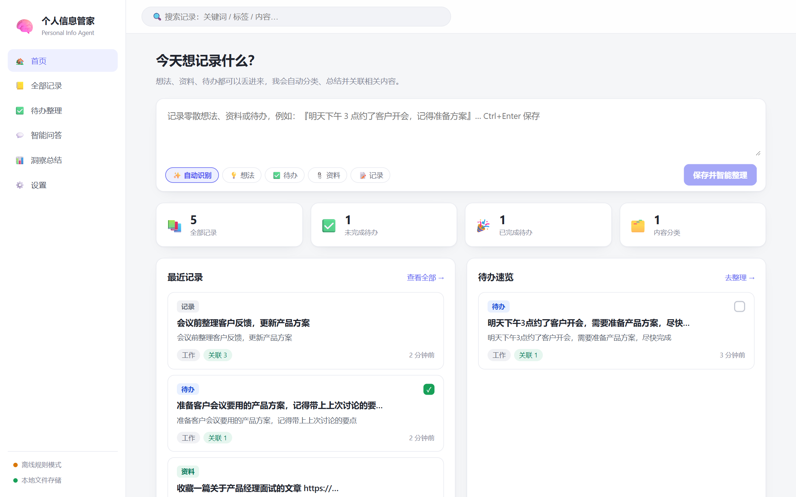
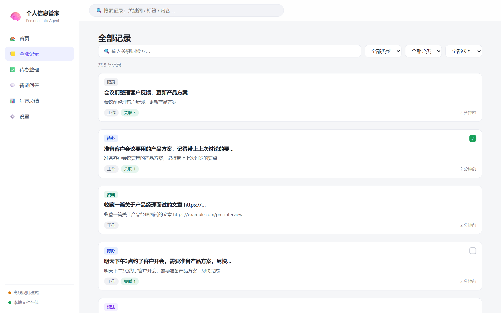
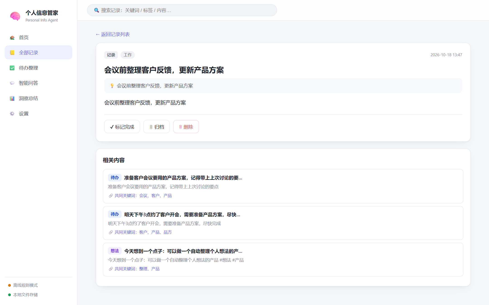
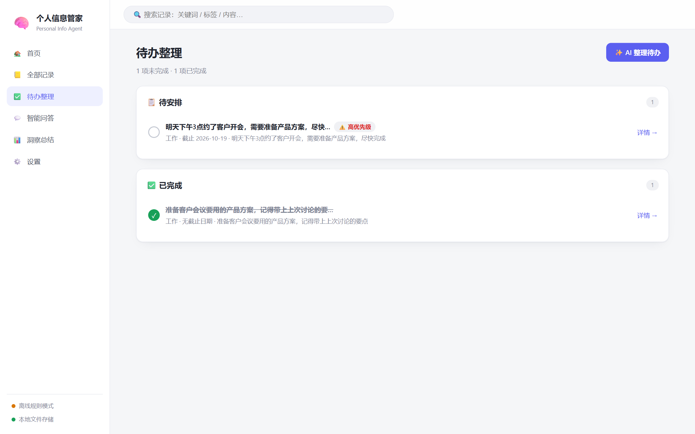
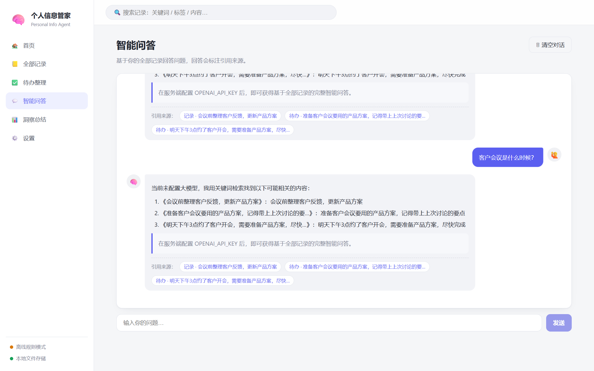
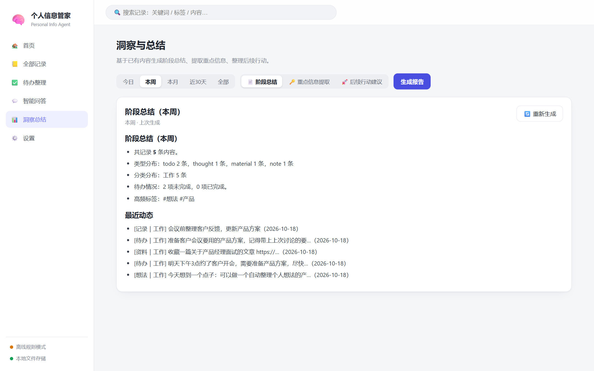
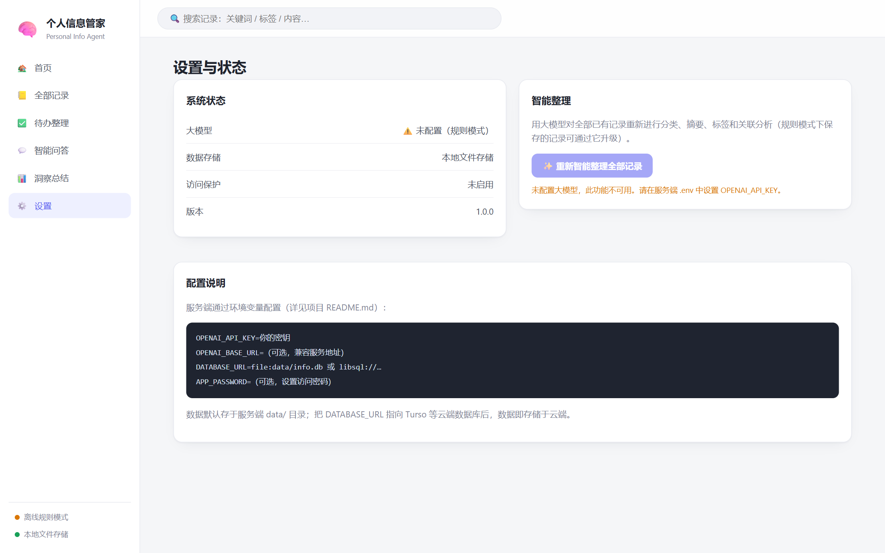

# 🧠 个人信息管家 Agent

一个把零散想法、资料和待办变成可用信息的个人知识管家 Web 应用。

记下一条内容，它会自动完成**类型识别、分类、摘要、打标签和关联分析**；你可以**关键词检索**全部记录、基于记录做**智能问答**、提取**重点信息**、**整理待办**，并一键生成**阶段总结与后续行动建议**。

## 功能一览

- 快速记录：想法 / 待办 / 资料一键输入，自动识别类型
- 智能整理：大模型自动分类、拟标题、写摘要、打标签、判断优先级与截止日期
- 自动关联：新记录与历史内容自动建立「相关内容」链接，并给出关联理由
- 关键词检索：标题、正文、摘要、标签全字段检索，支持类型 / 分类 / 状态筛选
- 智能问答：基于你自己的记录回答（带引用来源），拒绝编造；未配置模型时降级为关键词检索
- 批量导入：支持粘贴文本、txt/md 文件，以及结构化 JSON（如 DeepSeek 对话导出），自动拆分并打标签
- 待办整理：逾期 / 今天 / 待安排 / 已完成分组，一键生成建议处理顺序
- 重点提取 + 阶段总结 + 行动建议：按今日 / 本周 / 本月 / 近 30 天 / 全部生成报告
- 桌面端：Windows 安装版 / 绿色单文件版（内置服务，开箱即用，数据保存在用户目录）
- iOS 端：PWA 可安装到主屏幕；提供 Capacitor 原生工程（Mac + Xcode 上构建）
- 云端存储：一套代码同时支持本地文件数据库与云端数据库（Turso / libSQL）
- 访问保护：可选设置访问密码，登录令牌 HMAC 签名、30 天有效
- 优雅降级：未配置大模型时全部功能仍可用（规则分类、关键词关联、基础报告）

## 界面预览









## 快速开始

要求：Node.js ≥ 18。

```bash
cd personal-info-agent
npm install
cp .env.example .env      # Windows 可用 copy .env.example .env
npm run dev               # 同时启动后端(8787)与前端(5173)
```

打开 http://localhost:5173 即可使用。不配置任何环境变量也能跑：数据存在 `data/info.db`，分类与关联由内置规则完成。

生产模式（构建后由后端直接托管页面）：

```bash
npm run build
npm start                 # 打开 http://localhost:8787
```

## 配置大模型

编辑 `.env`，任选其一：

```bash
# OpenAI
OPENAI_API_KEY=sk-xxx
OPENAI_MODEL=gpt-4o-mini

# 或任意 OpenAI 兼容服务（DeepSeek / Moonshot / 通义 / 智谱等）
OPENAI_API_KEY=你的密钥
OPENAI_BASE_URL=https://api.deepseek.com/v1
OPENAI_MODEL=deepseek-chat
```

配置后重启服务：记录保存时会自动完成 AI 分类 / 摘要 / 关联；问答、报告、待办整理也会升级为模型生成。设置页提供「重新智能整理全部记录」，可把之前规则模式下保存的记录一次性升级。

> 兼容性说明：接口使用 OpenAI 兼容的 `chat.completions.create`；若服务不支持 JSON 输出模式会自动重试普通模式。部分服务不支持 `response_format`，已做自动降级处理。

也可以直接在应用「设置 → 大模型配置」里填写密钥、接口地址和模型名，保存即生效（环境变量优先）。桌面版则读取用户目录 `%APPDATA%\个人信息管家\.env`。

## 批量导入 DeepSeek 对话

打开「导入」页，任选一种方式：

- 粘贴：在 chat.deepseek.com 中全选复制对话，粘贴进来即可，多个对话用标题行或一行 `====` 分隔
- 文件：选择 `.txt` / `.md` / `.json`；结构化 JSON 支持 `{meta, conversations:[...]}` 格式，会保留每条对话的分类、摘要、要点与结论

导入的记录会打上「对话 / DeepSeek」标签并自动生成标题与分类，之后可以被检索、问答和复盘。

## 数据存储（本地 / 云端）

默认使用嵌入式数据库（单文件，零配置）：

```bash
DATABASE_URL=file:data/info.db
```

切换到云端只需改一个环境变量（以 Turso 为例）：

1. 在 [turso.tech](https://turso.tech) 注册并创建数据库：

   ```bash
   turso db create personal-info-agent
   turso db show personal-info-agent --url    # 得到 libsql://personal-info-agent-<org>.turso.io
   turso db tokens create personal-info-agent # 得到访问令牌
   ```

2. 写入 `.env`：

   ```bash
   DATABASE_URL=libsql://personal-info-agent-你的组织.turso.io
   DATABASE_AUTH_TOKEN=你的令牌
   ```

3. 重启服务。设置页状态栏会显示「云端数据库」。

本地文件模式便于单机使用与备份（直接拷贝 `data/` 目录即可）；云端模式适合多设备、多实例访问。

## 访问密码（建议上线后开启）

```bash
APP_PASSWORD=你的密码
APP_SECRET=随便一串长随机字符串   # 可选，用于签名登录令牌
```

设置后所有数据接口都需要登录令牌；令牌有效期 30 天，`APP_SECRET` 固定后重启服务不会让用户掉线。

## 发布上线

应用已包含 `Dockerfile`，可部署到任意支持 Docker 的平台。

### 方案 A：Railway（推荐，最简单）

1. 把本项目推送到 GitHub 仓库
2. 在 railway.app 新建项目 → Deploy from GitHub repo，自动识别 Dockerfile
3. 在 Variables 中添加 `OPENAI_API_KEY`、`DATABASE_URL`（建议直接指向 Turso）、`DATABASE_AUTH_TOKEN`、`APP_PASSWORD`
4. 生成域名即可访问；端口已固定为 8787，无需配置

### 方案 B：Render（支持一键蓝图）

仓库中已提供 `render.yaml`：在 dashboard.render.com → New → Blueprint，连接仓库后会自动创建 Web Service（Docker 运行时，健康检查 `/api/health`），随后在环境变量面板填入密钥即可。

### 方案 C：Docker 自部署（自有服务器）

```bash
docker build -t personal-info-agent .
docker run -d --name info-agent -p 8787:8787 \
  -v info-data:/app/data \
  -e OPENAI_API_KEY=sk-xxx \
  -e APP_PASSWORD=你的密码 \
  personal-info-agent
```

需要 HTTPS 时在前面挂一层 Nginx / Caddy 反代。

## 桌面端（Windows）

```bash
npm run build
npx electron-builder --win   # 产物在 release/ 目录
```

- `个人信息管家 Setup 1.0.0.exe`：安装版（推荐，自动创建桌面快捷方式）
- `个人信息管家 1.0.0.exe`：绿色单文件版，免安装直接运行

桌面版内置完整服务，数据与配置保存在 `%APPDATA%\个人信息管家\`（升级、卸载不丢数据）。默认端口 8787，若已被占用会自动复用已运行的服务。

## iOS 端

- 即刻可用：iOS Safari 打开应用地址 → 分享 → 「添加到主屏幕」，即可像 App 一样全屏使用（应用已内置 PWA 配置与图标）
- 原生 App：仓库已包含 `ios/` 工程（Capacitor）。在 Mac 上执行：

  ```bash
  npm install
  npm run build
  CAP_SERVER_URL=https://你的服务器地址 npx cap sync ios
  open ios/App/App.xcworkspace   # 用 Xcode 编译并安装到 iPhone
  ```

  注：编译 iOS 原生 App 需要 Mac、Xcode 和一个 Apple 账号；服务器端需先部署上线。

## API 一览

| 方法 | 路径 | 说明 |
| --- | --- | --- |
| GET | `/api/health` | 服务与配置状态 |
| POST | `/api/auth/login` | 登录获取令牌 |
| GET | `/api/auth/status` | 是否要求登录 |
| POST | `/api/entries` | 新建记录（自动整理） |
| GET | `/api/entries?q=&type=&category=&status=&limit=&offset=` | 记录列表与检索 |
| GET | `/api/entries/:id` | 单条记录 + 关联内容 |
| PATCH | `/api/entries/:id` | 修改（状态 / 标题 / 内容等） |
| DELETE | `/api/entries/:id` | 删除 |
| GET | `/api/search?q=` | 关键词检索（列表接口别名） |
| GET | `/api/todos` | 待办分组 |
| POST | `/api/todos/plan` | 待办整理建议 |
| POST | `/api/ask` | 智能问答（带引用） |
| GET/DELETE | `/api/chat/history` | 问答历史 |
| GET | `/api/insights?kind=summary|keypoints|actions&period=today|week|month|days30|all` | 阶段总结 / 重点提取 / 行动建议 |
| GET | `/api/stats` | 统计概览 |
| POST | `/api/reprocess` | 用大模型重新整理全部记录 |

## 目录结构

```text
personal-info-agent/
├── server/            # Node 后端（Express + libSQL + OpenAI SDK）
│   ├── index.js       # 路由与业务
│   ├── db.js          # 数据访问层（本地/云端同一套接口）
│   ├── ai.js          # 大模型：整理、问答、报告、待办规划
│   ├── rules.js       # 规则降级引擎（无模型时可用）
│   └── auth.js        # 密码登录与令牌
├── src/               # React 前端（Vite）
│   ├── pages/         # 首页 / 记录 / 详情 / 待办 / 问答 / 洞察 / 设置
│   └── components.jsx # 卡片、输入框、Markdown 等公共组件
├── dist/              # 构建产物（npm run build）
├── data/              # 本地数据库文件（已 gitignore）
├── Dockerfile
├── render.yaml        # Render 一键部署蓝图
└── .env.example       # 全部环境变量示例
```

## 常见问题

**没配大模型，功能会少吗？** 记录、检索、待办分组、规则版报告完全可用；分类 / 摘要 / 关联 / 问答 / 待办规划会使用内置规则降级实现，配置密钥后自动升级。

**数据安全？** 数据只保存在你自己的数据库里（本地文件或你自己的 Turso 实例），应用不向任何第三方上传。上线后务必设置 `APP_PASSWORD` 并通过 HTTPS 访问。

**想换别的云数据库？** 存储层集中在 `server/db.js`，接口是标准的查询函数（`listEntries` / `getEntry` / `updateEntry` 等），替换为 PostgreSQL / MySQL 只需改写这一个文件。

**时区？** 默认按 `Asia/Shanghai` 计算「今天 / 本周」等区间，可用 `APP_TIMEZONE` 修改。
